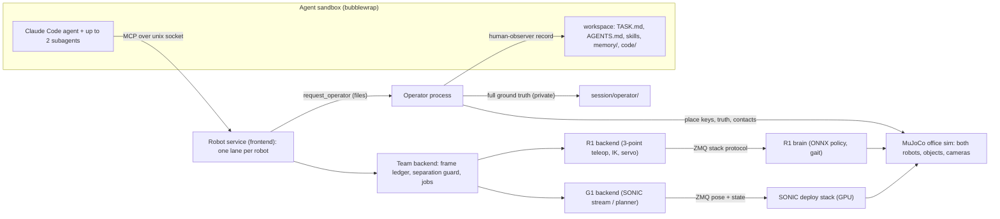

# RAX multi-robot framework: technical report

Unitree G1 + Unitree R1, one LLM agent, MuJoCo office simulation · branch `singler1+g1` at `7358b75` · state of 2026-11-15, 21:30

## 1. Summary

> **No task has succeeded yet.** In 17 from-scratch sessions on 2026-11-15 (two tasks, three task variants) neither the box carry nor the can-and-bin task met its success condition. The framework's own defects are largely fixed; what remains is the robots' motion precision under the present controllers.

RAX lets a single Claude Code agent explore a manipulation task with two robots through tool calls, write its own controllers and notes, and hand its experience to the next session. This report describes the framework as it stands on the `singler1+g1` branch, what was changed during one day of from-scratch runs, and what the runs showed.

- **What works.** Session launch, sandboxing, per-robot tools, resets with verified placement, a human-observer operator that gives no simulator coordinates, experience export and inheritance, parallel simulator instances, and (new) concurrent calls for the two robots.
- **How far the robots got.** Both robots lift the box with all four hands on it for up to 120 s. The G1 has picked the can from the desk and dropped it into the bin once. The G1 has lifted the bin and carried it 1.45 m once (partly dragging). The R1 has lifted the can about once in ten to twenty-five tries.
- **What blocks success.** Accurate small steps while holding something (both robots), the R1's hand accuracy near a light can, and placing a held box on the floor.

## 2. Goals and rules the framework is built to

These are the project owner's requirements, as stated during the work. They shape most design choices below.

| Rule | What it means in the framework |
|---|---|
| From scratch, frozen | The end state is a framework under which exploration from an empty workspace reaches success efficiently, with no framework changes during a session. |
| Harness only | Developers change mechanisms (tools, operator, instructions about method). They never give the agent findings, measurements, recommended values or hints about a task. |
| Human-observer operator | Between attempts the agent learns only what a person standing beside the robots could report. Positions and distances are the agent's to measure with the robots' sensors. |
| Task files state the task | A task file holds the task, its rule, the success condition and what the operator does. No dimensions, no route, no grasp advice. |
| Sim experience should transfer | The goal is the real G1 and R1. Sim-only information is kept out of what the agent learns from. |
| Review after every session | Each session is reviewed for harness causes of what went wrong, and the mechanism is changed before the next one. |

## 3. Architecture

One agent process talks to one robot service over MCP. The service owns both robots. A separate operator process plays the person in the lab: it resets the scene, judges attempts and answers requests. The agent can reach the robots only through the service.



| Component | Where | Role |
|---|---|---|
| Launcher | `rax/harness/claude_cli/` | Builds the workspace, starts Claude Code with an allow list and a sandbox, relays the model credential, keeps the robot clock. |
| Robot service | `rax/services/controller/frontend.py` | MCP server: tool list, validation, audit log (`mcp.jsonl`), operator requests. Runs one call per robot at a time. |
| Team backend | `rax/services/team/` | Combines the two robot backends, keeps a shared frame of both robots' poses, refuses base motions that bring them too close, runs grouped or background calls. |
| G1 backend | `rax/services/g1sonic/` | Streams references to the SONIC deploy stack, drives its walking planner, watches tilt, runaway and falls. |
| R1 backend | `rax/services/r1sonic/` | Inverse kinematics for the 5-joint arms, streams three target points, servo correction, gait calls. |
| Operator | `rax/scripts/g1r1_sim_operator.py` | Resets, placement, attempt review, progress and stall, robot standing-up, G1 stack restarts. |
| Simulation | `sim_team/`, `r1/sim/` | Office scene with both robots, objects, hand contact reports, two recording cameras. |

## 4. Robot interfaces

### G1 (29 joints, Dex3 hands, SONIC whole-body controller)

The SONIC model has three encoder modes: joint tracking (mode 0), teleop with planner legs and three hand points (mode 1), and SMPL (mode 2). The backend exposes them through these tools:

| Tool | What it does |
|---|---|
| `g1_status`, `g1_observe`, `g1_pixel_to_position` | Proprioception, head RGB-D image with camera pose, pixel to 3D point. |
| `g1_step` | Lowest level: rows of whole-body references (root height, orientation, 29 joints, hand closing), streamed at the control rate. |
| `g1_walk` | Planner walk by distance and turn, any direction in these sessions, with an option to hold the arms. |
| `g1_hands_walk` | Planner legs with hand points held in the pelvis frame and a squeeze (`press_m`). Used to hold an object while stepping. |
| `g1_planner` | Raw planner messages: mode, movement, facing, speed, hand points. |
| `g1_hand_shape`, `g1_hold` | Finger targets; drop any motion and hold the measured pose. |

Hidden in these sessions: `g1_crouch` (by owner's choice, so the agent builds crouches from `g1_step`) and the cuRobo arm planner tools, which need torch and cannot run in the service environment.

### R1 (PiPER grippers, 5-joint arms, SONIC_R1 teleop policy)

The R1 policy tracks three points (two wrists and the torso). The backend solves arm kinematics and streams those points; the legs follow a default stance or a streamed leg reference.

| Tool | What it does |
|---|---|
| `r1_status`, `r1_observe`, `r1_pixel_to_position` | State, head RGB-D image, pixel to 3D point. |
| `r1_move_hand` | Grasp point to a position with soft approach and finger axes. Servo correction from measured joints; `tolerance_m`, `servo_s` and a `reached` flag are new. |
| `r1_move_joints`, `r1_gripper`, `r1_hold` | Joint targets, gripper width (0–7 cm, 12 N per finger), hold. |
| `r1_head` | Head pitch and, new, yaw (±1.9 rad). |
| `r1_walk`, `r1_gait` | Scripted gait by distance, turn or side step; velocity gait that returns at once. |
| `r1_step` | Lowest level: streamed rows including a leg reference (used for crouches). |

### Team tools

`team_status`, `team_observe`, `team_set_pose` (the agent tells the frame where the robots are), `team_parallel` and `team_start`/`team_wait`/`team_stop` for calls on both robots that start together or run in the background.

### Concurrency (new on 2026-11-15)

The service used to run every tool call on one thread, so a call for one robot waited for the other's. It now holds one lane per robot: calls for different robots run at the same time, calls for the same robot run one after another, and team tools and operator requests hold every lane. The agent is told that a subagent can explore one robot's subtask while it explores the other's. A unit test and three simulator pairs (G1 turning while the R1 reaches, and two others) confirmed the overlap; the first full session using it was still running when this report was written.

## 5. Simulation

- **Scene.** A MuJoCo office: desk, chair, shelves, cabinet, drawer unit, mini fridge, low pedestal table, curtain wall. Scene variants live in `sim_team/scene_fridge` and `sim_team/scene_can`, each with an XML model and a `layout.json`.
- **Controllers in the loop.** The G1 runs the real SONIC deploy binary (TensorRT on the container's one GPU). The R1 runs its ONNX teleop policy in `sim_team/r1_brain.py`, stepped in lockstep with the physics.
- **Instances.** `TEAM_INSTANCE=n` shifts every port by 100·n and uses its own DDS domain, tmux session and log directory, so several sessions run side by side in the shared `sonic-sim2sim` container. Two instances are comfortable; three pushed the 64-core server to a load of 96–100.
- **Truth and contacts.** The sim publishes all poses and which hands touch the box, the can or the bin. Only the operator reads these.
- **Recording.** Each instance records a fixed top-down room camera and a camera that follows the object.

## 6. Operator

The operator stands in for a person in the lab. The agent reaches it with `request_operator`.

### Resets

- A reset puts the objects back and carries both robots to their starts, unless the request says `robots=stay`.
- `g1_at=x,y,yaw` and `r1_at=x,y,yaw` put a robot somewhere else for practice. A place is refused only where a person could not stand a robot: within 0.25 m of furniture or a wall, 0.33 m of the object's start, or 0.6 m of the other robot. A refusal moves nothing.
- After placing, the operator measures both robots and places again up to three times. The reply begins with a machine-readable `STATE` object.

### Human-observer replies

With `--reply human` (the default) the reply and the record the agent can read contain only what a person could see:

| Given to the agent | Kept private in `<session>/operator/` |
|---|---|
| Where the object ended (on its support, on the floor, tipped, held up); whether it left its support and for roughly how long; whether it fell or was pushed; which robots' hands were on it; whether the rule and the success condition were met; whether it was carried closer than ever before; whether the robots stand; the nominal places the robots were put. | World coordinates of objects and robots, distances to the goal, exact times, per-hand contact flags, the per-attempt review file. |

### Progress, pacing and use of the robots

- A stall notice comes first in the reply after eight lifted attempts without getting closer to the goal. Attempts in which the object never left its support are not counted.
- The reply states the robot time left and how long recent attempts took (the shorter ones, so the agent does not stop early).
- The reply reports each robot's minutes of motion so far, so an idle robot is visible.

### Recovery

The operator stands a fallen R1 up, restarts the G1's deploy stack after a fall (up to six times), re-arms after a guard trip it caused, and says so in the reply so the agent does not blame its own commands.

## 7. Agent side

- **Sandbox.** Claude Code runs with an explicit allow list. Shell commands run in bubblewrap: writes only in the workspace, no access to the repository, the simulator sockets, credentials or the session's private files.
- **Workspace.** `TASK.md`, `AGENTS.md` (method and safety rules rendered for this robot), `MCP_SESSION.md` (the tools actually offered), skills under `.agents/`, and `memory/`, `code/`, `output/` for the agent's own work.
- **Skills.** Interface skills per robot, and method skills that are task-independent: practice by stage, measure success, strategy review, avoid overfitting, spend the budget, and others. Passages about a tool are installed only when that tool is offered.
- **Attempt log.** `api.attempts` keeps a funnel of stages (grip, lift, carry, place) with counts, corrected from the operator's observations.
- **Experience.** At hand-over the agent rewrites `memory/CURRENT.md` and merges skills into a git skill library. `export_experience.sh` packs memory, code and the operator's record for the next session; unused files retire to `cold/`.
- **Budget.** Two robot hours, 3000 model calls, up to 200 resets, two subagents per session in these runs.

## 8. Tasks

| Task | What is asked | Rule checked by the operator |
|---|---|---|
| `office_box_fridge` | Both robots carry a plain box (0.41 × 0.31 × 0.26 m, 1.2 kg) from a low table to the floor in front of the fridge, about 3.2 m away, past the desk. | Whenever the box is off the table or floor, both hands of each robot are on it (2 s of slack). No pushing with legs. Furniture stays. |
| `office_can_bin` | One robot carries the trash bin (0.9 kg) to the other; the other takes an empty 15 g can from the desk and puts it in the bin. | The bin is lifted while it moves (not pushed or dragged), travels at least 1 m and ends within 0.9 m of the robot that handled the can; one robot per object. |
| `office_can_bin_roles` | The same, with roles assigned: the G1 carries the bin, the R1 handles the can. | As above, and the hands on each object must be the assigned robot's. |

The can now stands 5 cm in from the desk's edge at a random place along it at every reset (seed logged). The bin still stands in a corner beside a shelf and a cabinet, with one open face; whether to move it to open floor is an open decision for the owner.

## 9. Results

### Before the from-scratch line

An earlier line (sessions S29–S44, task `office_box_open`) had 0 successes. With interfaces and findings supplied by the developer it carried the box in the air with both robots for up to 3.4 m, though not to the goal. That line is what prompted the from-scratch, harness-only rules.

### From-scratch sessions on 2026-11-15

| Session | Conditions | Resets | State OK after reset | Best outcome |
|---|---|---|---|---|
| Fridge A1 | Full ground truth, first framework | 45 | not measured | Four-hand lift found; stuck on the sidestep |
| Fridge A2 | Inherits A1 | 33 | 12 / 33 | No lift progress; G1 walked back after resets |
| Fridge B1 | Fixed framework, from scratch | 29 | 24 / 29 | Four hands on for 97 s; closest 3.15 m |
| Fridge B2 | Inherits B1 | 37 | 22 / 37 | Closest 3.08 m |
| Fridge C1 | Human-observer replies, from scratch | 44 | 41 / 44 | 12 lifts, never with four hands |
| Fridge D1 | Cleaned docs, fixed G1 resets, from scratch | 58 | 50 / 58 | Four hands 34 s; closest 3.01 m |
| Fridge D2 | Inherits D1 | 35 | 30 / 35 | Four hands 120 s; rule kept in 2 lifts; closest 3.11 m |
| Fridge D3 | Inherits D1–D2; motion-time and stall changes | 22 | 22 / 22 | 11 four-hand lifts; closest 3.09 m; robots used equally |
| Fridge D4 | Inherits D1–D3 | 11 | — | Stopped after 50 min to relieve server load |
| Can 1 | Full truth, loose success rule | — | — | Can in bin twice, by the G1 walking to the bin (rule since tightened) |
| Can 2 | Tightened rule, from scratch | 6 | 0 / 6 | G1 held the can; R1 could not hold the bin |
| Can 3 | Human-observer, from scratch | 39 | 28 / 39 | Role choice misled by a leaked "0.35 m" claim in a skill |
| Can 5a | Cleaned docs, from scratch | 21 | 21 / 21 | R1 lifted the bin 0.21 m, then it slipped |
| Can 5b | Inherits 5a; can at the desk edge | 25 | 25 / 25 | G1 put the can in the bin once; bin never carried |
| Roles 1 | G1 bin, R1 can; from scratch | 25 | 25 / 25 | R1 lifted the can 1 time in about 25; G1 could not grip the bin |
| Roles 2 | Inherits Roles 1 (running) | 7+ | 6 / 7 | G1 lifted the bin and carried it 1.45 m, partly along the floor |
| Roles 2-parallel | Same start as Roles 2, concurrent robot calls (running) | — | — | Not yet known |

"Closest" is the box's smallest distance to the goal while carried with all four hands, from the private ground truth; the start is about 3.2 m. One further can session was aborted after 10 minutes because the agent took a parked box for the bin.

### Developer feasibility checks

These used simulator truth and were not shown to any agent.

- **R1 grasping the can.** With the can 0.2 m in from the desk edge the hand stopped about 6 cm short: 0 of 11. With the can at the edge: 1 lift in 7 executed tries; in the other six the hand knocked the can 5–13 cm on the way in. A stepped straight-line approach left the line by 1.5–3 cm and was not kept.
- **R1 sidestep.** A 0.27 m sidestep creeps 0.08–0.23 m forward, arms forward or not. A feedback term on the reference root did not fix it and was not kept.
- **G1 lifting the bin.** Not checked by the developer; shown possible by the Roles 2 session.

## 10. Defects found and fixed on 2026-11-15

Each was found by reviewing a session for harness causes. "Verified" says how the fix was checked.

| Symptom | Root cause | Fix | Verified |
|---|---|---|---|
| R1 left 40–93° off after resets with large turns (20 of 43 resets misplaced a robot) | The R1 controller's reference stayed at the old heading for 0.5 s after the pelvis was turned, and the policy turned it back | Reference moves to the asked pose before the robot is placed; arm targets stay robot-relative | sim 8 placements, worst 7.5° |
| G1 left 20–90° off, stumbled 0.3–0.9 m or fell after being placed (2 of 10) | A streamed hold re-anchored in place keeps pulling toward the heading its stream began with; and the runaway guard read the steps of a robot being turned as "stepped by itself" and disarmed it | A moved G1 goes through the planner's idle stand to a fresh streamed hold; the guard restarts after a re-anchor; one placement, service told at once | sim 8 placements, worst 3.8°, no fall; later sessions 21/21, 25/25, 22/22 |
| Squatting G1 half stood up when contact turned it | A heading-jump test meant to detect operator moves fired on contact | Test switched off; the operator tells the service explicitly | not yet in a session |
| Agent chose a worse role split from a wrong "fact" | Skills, tool descriptions and robot facts carried measured limits and advice from earlier tasks | Audit of everything the agent receives; findings removed, interface statements kept; other tasks' tools hidden; skill passages follow the offered tools | rendered workspace searched |
| Agent learned the scene from simulator coordinates | Reset replies carried world poses, distances and contact flags | Human-observer replies; full truth moved to a private directory | sessions |
| Practice stances refused; one session spent 71% of R1 motion walking | Stances were tied to the start places (0.2 m / 1 m) | Any place a person could stand a robot is allowed | sessions |
| "Leave the robots" requests moved them; a request naming the R1 moved nothing | The word "robot" anywhere in the message decided it | Robots go back on every reset unless `robots=stay`; a refusal moves nothing | sessions |
| A tool was listed and failed on every call | The arm planner needs torch, absent in the service environment | Tools that cannot run on the host are neither offered nor listed | unit tests |
| R1 could not look at its hand when the waist turned | Head yaw was held at 0 | `r1_head` takes yaw | sim; about 20% tracking error; real bridge untested |
| A hand 1.5 cm off was reported as done | Servo stopped after four corrections; no tolerance | `tolerance_m`, `servo_s`, `reached` | sim 1.4–2.8 mm at rest |
| A held can was reported "never lifted"; stall count included resets with no lift | Lift test required tilt under 20°; every reset counted as an attempt | Well above its support counts as lifted; stalls count lifted attempts only | unit tests, replay |
| Agent took a parked box for the bin | Unused objects were parked behind the curtain, in camera view | Parked 40 m away | session |
| One robot stood still most of the time (7 of 105 min) | The service ran one call at a time; instructions said one agent commands "the robot"; a skill said to park the other robot | One lane per robot; instructions and skill reworded; motion minutes reported | unit test, sim; first session running |

> Two attempted fixes were measured, found not to help and removed: a straight-line hand path for the R1, and forward-creep feedback for the R1 sidestep. One G1 unit test fails intermittently on timing; it did so before these changes too.

## 11. Open problems and limits

- **Small steps under load.** The G1's sidestep overshoots (asked 0.08–0.18 m, moved 0.10–0.26 m). The R1's sidestep creeps forward and its small sidesteps mostly turn it. A shared box tolerates only a few centimetres of mismatch, so the joint sideways shift past the low table fails.
- **R1 hand accuracy in motion.** At rest the grasp point can be servoed to 2 mm, but on the way it swings 1–3 cm, against 6–7 mm of clearance around the can. The R1's camera sees nothing closer than about 0.47 m.
- **G1 cannot crouch in planner mode.** The planner's height setting has no effect while idle, so the G1 cannot lower a box it holds with `g1_hands_walk`. Whether this is a wiring gap or a controller property is not yet established.
- **R1 and the bin.** One gripper on one wall lets the 0.9 kg bin rotate and slip; two grippers on opposite walls were not reachable in a crouch. No developer check has been made of this.
- **G1 grip endurance.** The G1's pinch on the box lets go after 2–3 minutes or about 0.6 m of walking.
- **Simulator ports are open.** The truth and contact ports are bound on localhost. The sandbox hides the host sockets that bypass the service, but this has not been audited for the sim's ZMQ ports.
- **Server capacity.** Three simulators overload the 64-core server. The container sees one GPU; using more needs the container recreated.
- **Residual wording.** About ten mild "X worked better" phrasings remain in method skills, and older option files still offer other tasks' tools.
- **Nothing here has run on the real robots.** The human-observer rule narrows the sim-to-real gap in what the agent learns, but contact reports and success checks still come from the simulator and would need a person or sensors on real hardware.

## 12. Next steps

1. Compare the serial and parallel Roles 2 sessions: per-robot motion minutes, and whether the bin carry and the can grasp both progress in one session.
2. Make small steps land where asked: cancel the G1 sidestep's overshoot inside the tool, and find why the R1 sidestep creeps forward.
3. Find out why the planner ignores the height setting, so the G1 can lower a held object.
4. Decide the bin's place (corner or open floor, with a random offset).
5. Check the sandbox against the simulator's truth ports.
6. Add a start-up self-test of every offered tool, so a broken tool is caught before a session spends time on it.

## 13. Running it

All commands run from the worktree `~/workspace/multirobot/singler1g1_wt`. Python runs only from `~/envs/rax-g1` (services, operator) and `~/envs/rax-agent` (the agent's scripts); the simulator runs inside the `sonic-sim2sim` container.

```bash
# 1. simulator (instance 0; add -e TEAM_INSTANCE=1 for a second one)
docker exec -e TEAM_SCENE_DIR=$PWD/sim_team/scene_can sonic-sim2sim \
  bash $PWD/sim_team/team_sim.sh start

# 2. configure a session (prints the session's operator-input.json)
RAX_ARTIFACT_ROOT=~/rax-runtime-<line> PYTHONPATH=$PWD/rax ~/envs/rax-g1/bin/python -B \
  rax/scripts/configure_session.py --task office_can_bin --task-file tasks/office_can_bin.md \
  --robot g1r1 --backend-options rax/scripts/g1r1_sim_all_interfaces_options.json \
  --agent-python ~/envs/rax-agent/bin/python --observation-profile rgbd --environment sim \
  --session-hours 2 --max-model-calls 3000 --subagents 2 [--experience <export>/workspace]

# 3. agent, then operator
(cd rax && bash scripts/start_agent.sh --config <session>/operator-input.json --non-interactive --no-gemini)
TEAM_SCENE_DIR=$PWD/sim_team/scene_can PYTHONPATH=$PWD/rax ~/envs/rax-g1/bin/python -B \
  rax/scripts/g1r1_sim_operator.py --session <session> --minutes 130 --max-resets 200

# 4. afterwards
bash rax/scripts/export_experience.sh <session> <export dir>
```

| Where | What |
|---|---|
| `<session>/mcp.jsonl` | Every tool call and result, with times. |
| `<session>/operator/ground_truth.jsonl` | Full truth per reset (private to the developer). |
| `<session>/stream/ground_truth.jsonl` | The human-observer record the agent reads. |
| `<session>/agent-workspace/memory/` | The agent's notes, funnel and hand-over. |
| `sim_team/logs[n]/overview*.mp4` | Recordings; copied per session to `~/workspace/multirobot/`. |
| `rax/local_tests/unit` | 279 unit tests (about 100 s). |

Useful operator switches: `--reply full` restores coordinate replies; `RAX_CAN_TASK_ROLES=can=r1,bin=g1` enforces assigned roles; `RAX_SCENE_SEED` fixes the can's placements; `--stall-attempts` sets the stall threshold.
