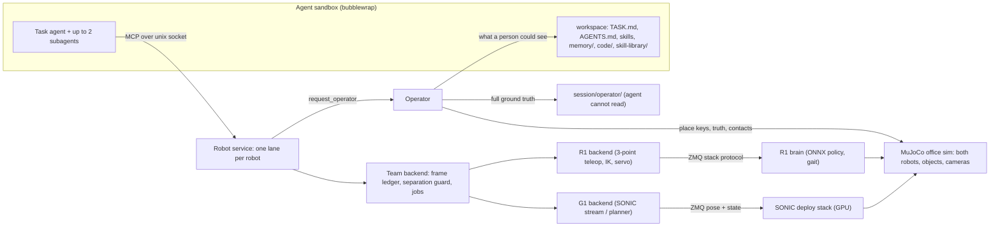
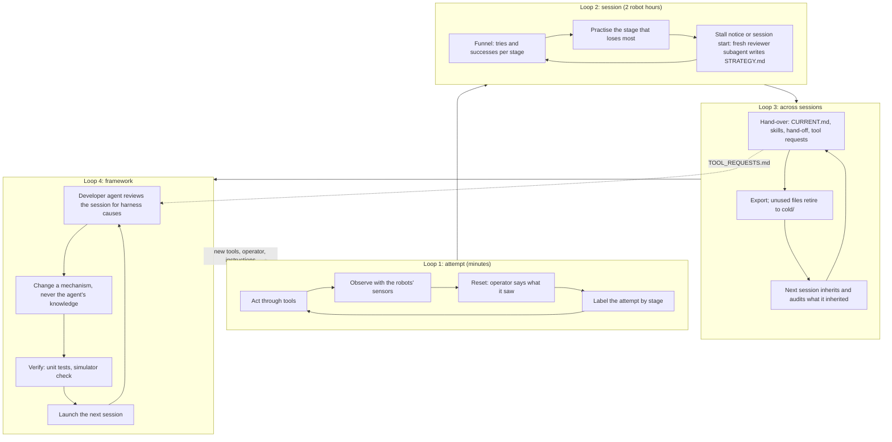

# RAX multi-robot framework: how it works and how it improves itself

Unitree G1 + Unitree R1, one LLM agent per session, MuJoCo office simulation. Branch `singler1+g1`, state of 2026-11-15.

This document describes the framework that is in use now and the mechanism by which the system gets better from one
attempt, one session and one framework revision to the next. Session-by-session results are not repeated here; the
short status is in section 9.

## 1. What the framework is

RAX gives one Claude Code agent two robots and a task written in plain language. The agent has no task-specific
controller. It looks through the robots' cameras, moves them with tool calls, writes its own code and notes, and asks
an operator to reset the scene between attempts. When the session ends it leaves its knowledge behind for the next
session.

"Self-improvement" here means four nested loops, each with its own memory and its own check against reality:

| Loop | Who improves what | Memory it writes | Checked against |
|---|---|---|---|
| Attempt | The agent improves one motion | Attempt log, run notes | Robot sensors, the operator's observation |
| Session | The agent improves its strategy and controllers | Stage funnel, strategy page, code | The funnel's counts; a fresh reviewer subagent |
| Across sessions | The agent improves what the next agent starts from | `CURRENT.md`, skill library, hand-off, tool requests | Validation at merge; usage accounting; the next session's audit |
| Framework | A developer agent improves the harness the task agent runs in | Commits to this repository | Unit tests, simulator checks, the next session's review |

The model's weights never change. Everything that improves is an artifact: code, notes, skills, or the harness itself.

## 2. The agents and other actors

| Actor | What it is | What it may do |
|---|---|---|
| Task agent | Claude Code in a sandbox, one per session | Call robot tools, write code and notes in its workspace, ask the operator, start subagents |
| Subagents | Up to two per session, started by the task agent | Same tools. Used for a fresh strategy review, for perception, and to explore one robot's subtask while the task agent explores the other's |
| Operator | A script that plays the person in the lab (not an LLM) | Reset the scene, place robots, judge attempts, stand a fallen robot up |
| Developer agent | Claude Code outside the sandbox, between sessions | Review sessions for harness causes, change mechanisms, verify, launch the next session |
| Review subagents | Started by the developer agent | Read a finished session and report mechanism defects; audit what the agent is given for leaked findings |
| Owner | The human | Sets the tasks and the rules in section 7; decides anything about the task itself |

## 3. Runtime architecture



| Component | Where | Role |
|---|---|---|
| Launcher | `rax/harness/claude_cli/` | Builds the workspace, starts Claude Code with an allow list and a sandbox, relays the model credential, keeps the robot clock |
| Robot service | `rax/services/controller/frontend.py` | MCP server: tool list, validation, audit log (`mcp.jsonl`), operator requests |
| Team backend | `rax/services/team/` | Joins the two robot backends, keeps both robots' poses in one frame, refuses base motions that bring them too close |
| G1 backend | `rax/services/g1sonic/` | Streams references to the SONIC deploy stack, drives its walking planner, guards tilt, runaway and falls |
| R1 backend | `rax/services/r1sonic/` | Arm inverse kinematics, three streamed target points, servo correction, gait |
| Operator | `rax/scripts/g1r1_sim_operator.py`, `human_view.py`, `attempt_review.py` | Resets, placement, attempt judgement, progress and stall, recovery |
| Simulation | `sim_team/`, `r1/sim/` | Office scene, both robots under their real controllers, contact reports, recordings |
| Agent instructions | `rax/auto_research_agent/AGENTS.md`, `rax/agent_skills/` | Method and safety rules; interface and method skills |

The agent reaches the robots only through the service. Its shell runs in a sandbox that can write only in the
workspace and cannot read the repository, the simulator's sockets, credentials or the session's private files.

## 4. What the agent can do with the robots

The interface is deliberately low level. Tool descriptions state arguments, frames, units and code-enforced limits,
and nothing learned from earlier tasks.

**G1** (29 joints, Dex3 hands, SONIC whole-body controller)

| Tool | What it does |
|---|---|
| `g1_status`, `g1_observe`, `g1_pixel_to_position` | Proprioception, head RGB-D image with camera pose, pixel to 3D point |
| `g1_step` | Rows of whole-body references (root height, orientation, 29 joints, hand closing) at the control rate |
| `g1_walk` | Planner walk by distance and turn, with an option to hold the arms |
| `g1_hands_walk` | Planner legs with hand points held in the pelvis frame and a squeeze; holds an object while stepping |
| `g1_planner` | Raw planner messages: mode, movement, facing, speed, hand points |
| `g1_hand_shape`, `g1_hold` | Finger targets; drop any motion and hold the measured pose |

**R1** (PiPER grippers, 5-joint arms, SONIC_R1 teleop policy that tracks two wrists and the torso)

| Tool | What it does |
|---|---|
| `r1_status`, `r1_observe`, `r1_pixel_to_position` | State, head RGB-D image, pixel to 3D point |
| `r1_move_hand` | Grasp point to a position with soft approach and finger axes; servo to a tolerance; reports `reached` |
| `r1_move_joints`, `r1_gripper`, `r1_head`, `r1_hold` | Joint targets, gripper width, head pitch and yaw, hold |
| `r1_walk`, `r1_gait` | Scripted gait by distance, turn or side step; velocity gait that returns at once |
| `r1_step` | Streamed rows including a leg reference (used for crouches) |

**Team**: `team_status`, `team_observe`, `team_set_pose`, `team_parallel`, `team_start` / `team_wait` / `team_stop`.

**Concurrency.** The service holds one lane per robot. Calls for different robots run at the same time, calls for one
robot run one after another, and team tools and operator requests hold every lane. This is what lets a subagent
explore one robot's subtask while the task agent explores the other's.

## 5. The operator and the information boundary

The operator is where the system meets ground truth, so what it tells the agent is controlled.

- **Reset.** Objects go back; both robots go back to their starts unless the request says `robots=stay`. `g1_at=x,y,yaw`
  and `r1_at=x,y,yaw` put a robot anywhere a person could stand it, for practice. The operator measures the result,
  places again if needed, and opens its reply with a machine-readable `STATE` object.
- **What the agent is told** is what a person beside the robots could see: where the object ended, whether it left
  its support and roughly how long, whether it fell or was pushed, which robots' hands were on it, whether the task's
  rule and success condition were met, whether it was carried closer than ever before, whether the robots stand, and
  the nominal places the robots were put.
- **What stays private**: world coordinates, distances, exact times, per-hand contact flags and the detailed attempt
  review. They go to `<session>/operator/`, which the agent cannot read, and are used only for developer review.
- **Signals about the session**: a stall notice after eight lifted attempts without getting closer; the robot time
  left; each robot's minutes of motion so far.

The boundary exists so that what the agent learns is what it could also learn on the real robots.

## 6. The self-improvement mechanism



### Loop 1: one attempt

1. The agent acts, then looks. Arm and walk tools return what was achieved, not only what was asked: remaining hand
   error and a `reached` flag, distance walked against distance asked, tilt, steps taken.
2. It asks for a reset. The reply says what the operator saw of the attempt.
3. It records every try of every stage with `api.attempts`. When the operator's observation contradicts what the
   agent believed (for example a lift it judged from the camera), it corrects the row with
   `api.attempts.correct(t, ok, why)`, and the funnel counts the correction.

### Loop 2: one session

- **A funnel instead of an impression.** `python -m api.attempts` prints tries and successes per stage (grip, lift,
  carry, place), for this session and over all sessions. The method skills tell the agent to work on the stage that
  loses the most, and to practise that stage alone and repeatedly from its own start state once whole attempts keep
  failing there. Resets with `g1_at` / `r1_at` exist to make that practice cheap.
- **A fresh look.** At the start of a session, and again when the operator reports a stall, the agent starts a
  subagent that has not seen its plans. The subagent reads the task, the notes, the funnel, the operator's record and
  the tool requests, and writes a one-page `memory/STRATEGY.md`: where the task stands in numbers, the bottleneck and
  whether it is a skill, method or tool problem, two or three strategies with a recommendation, and what to stop doing.
- **Exclusions are audited.** The reviewer lists every rule in the notes that rules something out ("never",
  "impossible", "does not work") with its evidence: how many tries, in which session, and what else could explain
  them. A rule resting on one or two tries is reopened as a question with the cheapest test that would settle it.
  This is the guard against an agent's mistake becoming the next agent's fact.
- **Controllers as code.** What works is written under `code/` as steps that check their own preconditions and
  results, so later attempts are cheaper and comparable.

### Loop 3: across sessions

Robot work ends some minutes before the session does, and the agent is asked to hand over.

| What it leaves | Content | How it is kept honest |
|---|---|---|
| `memory/CURRENT.md` | The state of knowledge, rewritten rather than appended, at most 30 KB: stage graph, funnel, what works with its run command, what does not and why, the recommended next step | The next session's reviewer audits its exclusions |
| Skill library | Executable skills: `SKILL.md`, code with a `main(ctx, ...)`, and `evidence/runs.jsonl` with one row per run; each skill carries its measured success rate and a status (`draft`, `verified`) | `skill_library_merge` validates the format and compiles the code before merging the session's branch into the library's `main`; the harness, not the agent, owns the library |
| `handoff/README.md` | How to plan each subtask's motion in a differently laid-out scene | Read first by a session in a new scene |
| `memory/TOOL_REQUESTS.md` | What the tools cannot do that the task needs, with numbers | Read by the developer agent; the only channel from the task agent to the harness |
| `memory/attempts.jsonl`, `STAGES.json` | The raw funnel | Recomputed, never summarised by hand |

`export_experience.sh` packs memory, code, the hand-off, the operator's record and a bundle of the skill library.
`retire_unused.py` then moves every memory or code file that the session neither opened nor ran into `cold/`, decided
from the session's own transcripts and tool log. Notes otherwise only grow, and the author of a note is a poor judge
of whether it is still useful. The next session is configured with `--experience <export>/workspace`.

### Loop 4: the framework

After every session the developer agent reviews it for causes in the harness, not for ways to solve the task.

1. **Review.** A review subagent reads the session's tool log, the private ground truth, the operator log and the
   agent's notes and transcripts, and reports facts with counts and inferences separately, ending in a short ranked
   list of mechanism changes with how each would be measured.
2. **Change a mechanism.** Typical changes: a tool reports what it achieved; the operator verifies its own
   placements; a tool that cannot run on the host is not offered; a stale instruction is reworded.
3. **Verify before use.** Unit tests (279 at present) and, for anything touching motion, a scripted check in the
   simulator. A change that does not measurably help is removed again.
4. **Launch the next session** on the changed framework, and compare.

Two things this loop is not allowed to do are what keep it from becoming hand-tuning; they are rules 1 and 2 in the
next section.

### What makes the loops trustworthy

- **Two records of every attempt.** The agent sees an observer's account; the developer sees full ground truth. The
  agent cannot overfit to simulator coordinates, and the developer can still tell whether the agent's beliefs are true.
- **Counts travel with claims.** Stages carry tries and successes, skills carry run logs, exclusions carry evidence.
- **Corrections are first-class.** A relabelled attempt stays in the log with its reason.
- **Forgetting is mechanical.** Unused material retires by usage, not by anyone's opinion.
- **The agent cannot edit the harness.** Its only influence on it is a written request with numbers.

## 7. Rules the framework is held to

1. **Harness only.** Developers change mechanisms. They never give the agent findings, measurements, recommended
   values or hints about a task.
2. **No inherited findings in the interface.** Skills, tool descriptions and robot facts state interfaces only. An
   audit of everything the agent receives removed measured limits and advice left over from earlier tasks, after one
   such line decided a role split wrongly.
3. **Human-observer operator.** Section 5.
4. **Task files state the task**: the task, its rule, the success condition and what the operator does.
5. **From scratch, frozen.** The target is a framework under which an empty workspace reaches success efficiently
   with no framework change during a session.
6. **Review after every session**, then change the mechanism before the next one.

## 8. Tasks in use

| Task | What is asked | Rule checked by the operator |
|---|---|---|
| `office_box_fridge` | Both robots carry a plain box from a low table to the floor in front of the fridge, past the desk | Whenever the box is off the table or floor, both hands of each robot are on it |
| `office_can_bin` | One robot carries the trash bin to the other; the other takes an empty can from the desk edge (random place along it) and puts it in the bin | The bin is lifted while it moves, not pushed or dragged, and ends beside the robot that handled the can |
| `office_can_bin_roles` | The same with roles assigned: G1 carries the bin, R1 handles the can | As above, and each object is handled by its assigned robot |

## 9. Status and limits

- **No task has met its success condition yet.** Reached so far: both robots lift the box with all four hands on it
  for up to 120 s; the G1 has put the can in the bin once; the G1 has lifted and carried the bin about 1 m; the R1
  has lifted the can roughly once in ten to twenty-five tries.
- **What blocks success is motion precision under the present controllers**: accurate small steps while holding
  something, the R1's hand accuracy near a light object, and lowering a held box to the floor.
- **Concurrent calls for the two robots are new.** They pass a unit test and three simulator pairs; their first full
  session had not finished when this was written.
- **Loop 4 still depends on a developer agent outside the session.** The task agent cannot change its own tools.
- **Nothing has run on the real robots.** On real hardware the operator's observations would come from a person or
  from sensors.
- **Capacity.** Two simulators run comfortably on the 64-core host; three overload it.

## 10. Running it

All commands run from the worktree. Python runs only from `~/envs/rax-g1` (services, operator) and
`~/envs/rax-agent` (the agent's scripts); the simulator runs inside the `sonic-sim2sim` container.

```bash
# 1. simulator (instance 0; add -e TEAM_INSTANCE=1 for a second one)
docker exec -e TEAM_SCENE_DIR=$PWD/sim_team/scene_can sonic-sim2sim \
  bash $PWD/sim_team/team_sim.sh start

# 2. configure a session (prints the session's operator-input.json)
RAX_ARTIFACT_ROOT=~/rax-runtime-<line> PYTHONPATH=$PWD/rax ~/envs/rax-g1/bin/python -B \
  rax/scripts/configure_session.py --task office_can_bin --task-file tasks/office_can_bin.md \
  --robot g1r1 --backend-options rax/scripts/g1r1_sim_all_interfaces_options.json \
  --agent-python ~/envs/rax-agent/bin/python --observation-profile rgbd --environment sim \
  --session-hours 2 --max-model-calls 3000 --subagents 2 [--experience <export>/workspace]

# 3. agent, then operator
(cd rax && bash scripts/start_agent.sh --config <session>/operator-input.json --non-interactive --no-gemini)
TEAM_SCENE_DIR=$PWD/sim_team/scene_can PYTHONPATH=$PWD/rax ~/envs/rax-g1/bin/python -B \
  rax/scripts/g1r1_sim_operator.py --session <session> --minutes 130 --max-resets 200

# 4. afterwards: pack the experience for the next session
bash rax/scripts/export_experience.sh <session> <export dir>
```

| Where | What |
|---|---|
| `<session>/mcp.jsonl` | Every tool call and result, with times |
| `<session>/operator/ground_truth.jsonl` | Full truth per reset (developer only) |
| `<session>/stream/ground_truth.jsonl` | The observer's record the agent reads |
| `<session>/agent-workspace/memory/` | The agent's notes, funnel and hand-over |
| `<artifact root>/skill-library/<robot>/` | The persistent skill library (git) |
| `rax/local_tests/unit` | Unit tests |

Operator switches: `--reply full` restores coordinate replies; `RAX_CAN_TASK_ROLES=can=r1,bin=g1` enforces assigned
roles; `RAX_SCENE_SEED` fixes the can's placements; `--stall-attempts` sets the stall threshold.
